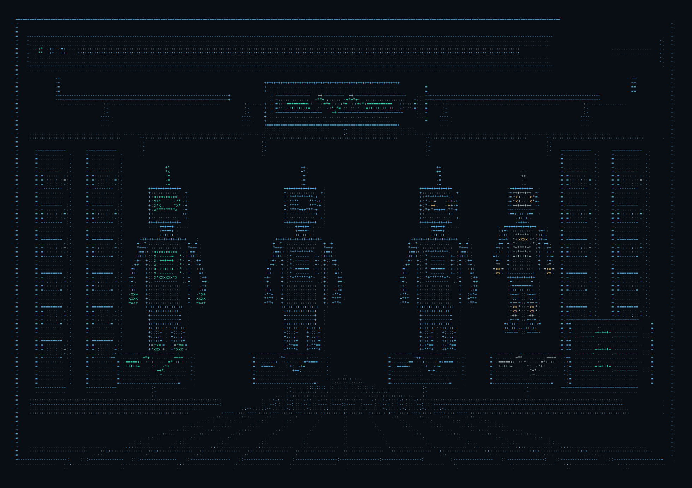

 <p align="center">
  

</p>


```text
                                                                    
   
                                                                    
          ██╗ █████╗ ██╗   ██╗███████╗██████╗ ██╗ █████╗           
          ██║██╔══██╗██║   ██║██╔════╝██╔══██╗██║██╔══██╗          
          ██║███████║██║   ██║█████╗  ██████╔╝██║███████║          
     ██   ██║██╔══██║╚██╗ ██╔╝██╔══╝  ██╔══██╗██║██╔══██║          
     ╚█████╔╝██║  ██║ ╚████╔╝ ███████╗██║  ██║██║██║  ██║          
      ╚════╝ ╚═╝  ╚═╝  ╚═══╝  ╚══════╝╚═╝  ╚═╝╚═╝╚═╝  ╚═╝          
                                                                    
                    J A V E R I A   Y A S I N
                                                                    
          SOFTWARE ENGINEER  //  AI SYSTEMS ARCHITECT
                                                                    
       [ BOOTING PERSONALITY.EXE .................... OK ]
       [ LOADING QUESTIONABLE IDEAS ................. OK ]
       [ INITIALIZING 4 UNNECESSARY AGENTS .......... OK ]
       [ CHECKING FOR BUGS .......................... FOUND ]
       [ BLAMING THE COMPILER ....................... OK ]
                                                                    
       SYSTEM MESSAGE: IT WORKS ON MY MACHINE.
       HUMAN STATUS: PROBABLY OVERENGINEERING SOMETHING.
                                                                    
                  >>> WELCOME TO JAVERIA LABS <<<

```

<p align="center">
  <a href="https://github.com/yjaveria3-netizen">GITHUB</a> &nbsp; // &nbsp;
  <a href="https://www.linkedin.com/in/javeria-yasin-6a7863387/">LINKEDIN</a> &nbsp; // &nbsp;
  <a href="mailto:yjaveria3@gmail.com">EMAIL</a>
</p>

---

# `01 // WHO IS RUNNING THIS THING?`

Hello, I'm Javeria.

Software Engineering student at **FAST-NUCES Lahore**, backend enthusiast, AI systems builder, and the person who occasionally turns a 20-line solution into a distributed architecture.

I build things that solve problems. Sometimes I also build things that create entirely new problems. Both are excellent learning opportunities.

My current interests live somewhere between:

- Autonomous AI agents and multi-agent orchestration.
- Backend engineering and API architecture.
- PostgreSQL and database internals.
- Full-stack SaaS applications.
- Automation, security and systems design.

I enjoy understanding how things work underneath the abstraction. Especially when the abstraction starts behaving suspiciously.

**Current philosophy:** Good engineering is about solving the actual problem. Great engineering is knowing when to stop adding unnecessary components. I'm still working on the second part.

---

# `02 // THE AUTONOMOUS WORKFORCE`

### Four agents. One orchestrator. Zero accountability.

Why do everything yourself when you can build a system where four AI agents disagree with each other before producing the same answer?

My multi-agent experiments revolve around specialized autonomous workers, task delegation, asynchronous execution and iterative refinement.

```text id="a0vfw6"
                    +-----------------------+
                    |     HUMAN OPERATOR    |
                    |      JAVERIA YASIN    |
                    +-----------+-----------+
                                |
                                v
                    +-----------------------+
                    |     ORCHESTRATOR      |
                    |-----------------------|
                    | Task decomposition    |
                    | Agent coordination    |
                    | Execution management  |
                    +-----------+-----------+
                                |
              +-----------------+-----------------+
              |                 |                 |
              v                 v                 v

       +-------------+   +-------------+   +-------------+
       |   PLANNER   |   |    CODER    |   |   CRITIC    |
       |-------------|   |-------------|   |-------------|
       | Thinks first|   | Writes code |   | Finds flaws |
       | Makes plans |   | Builds stuff|   | Rejects it  |
       | Splits tasks|   | Fixes stuff |   | Complains   |
       +------+------+   +------+------+   +------+------+
              |                 |                 |
              +-----------------+-----------------+
                                |
                                v
                    +-----------------------+
                    |        REFINER        |
                    |-----------------------|
                    | Reviews outputs       |
                    | Resolves conflicts    |
                    | Improves implementation|
                    +-----------+-----------+
                                |
                                v
                    +-----------------------+
                    |       VALIDATION      |
                    |-----------------------|
                    | Tests                 |
                    | Logic                 |
                    | Edge cases            |
                    +-----------+-----------+
                                |
                       +--------+--------+
                       |                 |
                      PASS              FAIL
                       |                 |
                       v                 v
                    DEPLOY          TRY AGAIN
```

**Architecture interests:**

- Decentralized agent workflows.
- Specialized worker responsibilities.
- Autonomous task planning.
- Asynchronous execution.
- Inter-agent communication.
- Critique and refinement loops.
- LLM-powered automation.

**Intelligence providers:** Groq API and Gemini API.

I like building systems where agents actually execute responsibilities rather than simply describe what a hypothetical agent might do.

---

# `03 // THE WORKSHOP`

The repositories, experiments, unfinished masterpieces and occasional questionable decisions live here:

<p align="center">
  <a href="https://github.com/yjaveria3-netizen">
    <strong>EXPLORE THE REPOSITORIES →</strong>
  </a>
</p>

---

# `04 // THE ENGINEERING INVENTORY`

I don't believe in adding technologies to a README just because their logos look good together.

Here's the stack I actually work with and experiment with.

| Department | Technologies |
|---|---|
| Languages | Python, C++, JavaScript |
| Backend | FastAPI, REST APIs |
| Frontend | Next.js, React |
| Database | PostgreSQL, SQL |
| AI / LLM | Groq API, Gemini API |
| AI Architecture | Multi-agent orchestration |
| Real-time | LiveKit, WebRTC |
| Automation | GitHub Actions, CI/CD |
| Security | PyJWT, PostgreSQL RLS |
| Data Processing | Pandas |

**Database preference:** PostgreSQL.

**Query preference:** Raw SQL when I want control.

**Backend preference:** FastAPI.

**Infrastructure preference:** Keep it simple until complexity is actually justified.

---

# `05 // SECURITY DIVISION`

**Position:** Deputy Head, GLI Security Team.

I enjoy building systems, but I also enjoy thinking about how they can be broken.

Areas of interest:

- Authentication and authorization.
- JWT-based token validation.
- PostgreSQL Row-Level Security.
- Environment and secrets management.
- Application security.
- Access control and secure backend design.

A system isn't finished just because the happy path works.

The unhappy paths deserve attention too.

---

# `06 // AUTOMATION DEPARTMENT`

My repositories occasionally do more work while I'm asleep than I do while I'm awake.

Things I work with:

- GitHub Actions.
- Automated branch protections.
- CI/CD workflows.
- Background validation scripts.
- Repository maintenance.
- Contribution graph automation.
- Automated status synchronization.

If a task is repetitive, it probably shouldn't require a human every time.

If the automation breaks, we automate the debugging process.

If that breaks, we have a bigger problem.

---

# `07 // LIVE SYSTEM CONFIGURATION`

```yaml id="tt5ys5"
operator:
  name: Javeria Yasin
  role: Software Engineering Student
  location: Lahore, Pakistan

interests:
  - Agentic AI
  - Backend Engineering
  - Full-stack Development
  - Database Architecture
  - Automation
  - Application Security

current_experiments:
  - Autonomous AI systems
  - Multi-agent SaaS architectures
  - Intelligent automation pipelines

preferred_stack:
  backend: FastAPI
  frontend: Next.js
  database: PostgreSQL
  intelligence:
    - Groq
    - Gemini

system_metrics:
  coffee_dependency: CRITICAL
  sleep_schedule: UNDEFINED
  debugging_method: CONTROLLED CHAOS
  overengineering: UNDER INVESTIGATION
  bugs: UNDOCUMENTED FEATURES

system_status: OPERATIONAL
```

---

# `08 // IMPORTANT ENGINEERING DOCUMENTATION`

```text
// TODO: Fix the bugs.

// FIXME: The bugs are now features.

// HACK: This works. Do not touch.

// NOTE: Nobody approved this architecture.

// REVIEW: Why are there four agents?

// ANSWER: Because one agent wasn't enough.
```

And the most frequently used Git command:

```bash
git add .
git commit -m "final final actually_final_v7"
git push origin main
```

---

# `09 // ESTABLISH CONNECTION`

Have an interesting engineering problem, an ambitious project, or an AI system that needs an unreasonable amount of orchestration?

Let's talk.

**GitHub:** [@yjaveria3-netizen](https://github.com/yjaveria3-netizen)

**LinkedIn:** [Javeria Yasin](https://www.linkedin.com/in/javeria-yasin-6a7863387/)

**Email:** [yjaveria3@gmail.com](mailto:yjaveria3@gmail.com)

---

```text id="r7m2gf"
    =========================================================

                 JAVERIA LABS // TERMINAL CLOSED

         FOUR AGENTS HAVE FINISHED THEIR ASSIGNMENTS.

             ONE AGENT HAS OPENED A NEW PULL REQUEST.

                   THE CRITIC HAS REJECTED IT.

               THE CODER IS ASKING FOR REQUIREMENTS.

                  THE PLANNER IS MAKING A PLAN.

               THE HUMAN HAS GONE TO GET COFFEE.

    =========================================================
```

<p align="center">
  <sub>Built with curiosity, questionable architectural decisions, and PostgreSQL.</sub>
</p>
